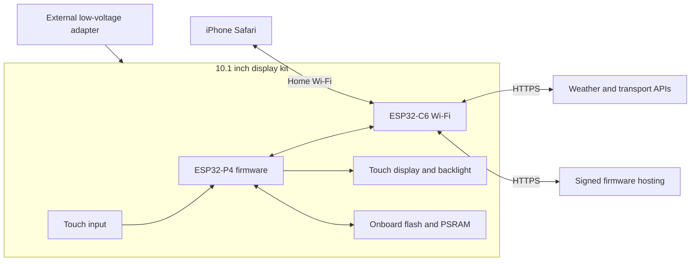

# Home display hardware and software design

2 November 2026 • Revised v1 design for the selected 10.1-inch ESP32-P4 display

Build a standalone embedded appliance using a Waveshare ESP32-P4-WIFI6-Touch-LCD-10.1 kit. This is the working model for the user's selected 10-inch P4 screen; confirm supplier revision before ordering. The earlier 14-inch HDMI display, Raspberry Pi, Linux and SSD design is superseded. The [PRD](PRD.md) retains all three views, local iPhone controls and mandatory OTA recovery.

## Hardware layout

The family integrates P4 application processing, a C6 wireless coprocessor, 32 MB PSRAM and 32 MB NOR flash according to [Waveshare documentation](https://docs.waveshare.com/ESP32-P4-WIFI6-Touch-LCD-X). Validate these capacities on the shipped revision. No additional computer, external Wi-Fi module or SSD is required. Use the kit's display/touch connections and documented backlight interface; HDMI and DDC/CI are no longer part of this design.

The manufacturer's [example repository](https://github.com/waveshareteam/ESP32-P4-WIFI6-Touch-LCD-X) lists the 10.1-inch variant at 800 × 1280 native resolution. Design for 1280 × 800 landscape and test both display rotation and touch mapping. Confirm the Wi-Fi network supports the board's 2.4 GHz connection. Power the complete kit through its documented input using the specified external supply; exact adapter/current and supplied accessories remain procurement checks.

## Mechanical concept

A nominal 10.1-inch 16:10 active image is approximately 218 × 136 mm, calculated from diagonal/aspect ratio, not a measured panel outline. Do not reuse the old 14-inch enclosure envelope. Final bezel and housing dimensions depend on the manufacturer's drawing, actual board, connectors, cable bends and stand.

Use a matte black bezel, removable rear cover, stable tilted stand and ventilation. Keep touch glass free of clamp stress and the Wi-Fi antenna clear. Preserve access to power, BOOT/RESET and programming connectors, including coprocessor recovery access. Use threaded inserts and screws for serviceability. Split printed parts if the printer volume requires it. PETG is the initial material choice; qualify enclosure temperature and stability. No battery or additional fan is planned unless thermal testing establishes a need.

## Firmware and phone interface

Use ESP-IDF in C/C++ with FreeRTOS tasks and LVGL for the on-device UI. Pin a board-supported toolchain and BSP after bring-up. The phone receives a lightweight HTML/CSS/JavaScript interface from an embedded web server; the device itself does not run a browser, Node.js, systemd or Linux.

- UI task: clock/weather/transport views, touch, theme, rotation and state rendering. Network operations never block rendering.
- Network tasks: HTTPS provider calls, bounded parsing, cache, retry and quota scheduling through the C6.
- Local control: pairing, authenticated settings/navigation commands and live status shared with the UI.
- Settings: versioned NVS records with migration-safe copies; bounded RAM caches and limited flash writes.
- Hardware adapter: display rotation, touch, actual backlight control and time/network services.
- Update task: authenticated firmware download, progress and boot-health confirmation.

Use provider-neutral Location, WeatherConditions, Forecast, Stop, Line, Departure and Disruption records. Keep UTC timestamps, source timestamps, freshness and live/scheduled status. Views register their identifiers, configuration and render functions; additions arrive through firmware releases and must meet resource budgets. No downloadable arbitrary scripts in v1.

Bound request sizes, JSON depth, forecast length, cached stops and simultaneous TLS connections. One 1280 × 800 RGB565 framebuffer is about 1.95 MiB; two require about 3.91 MiB before LVGL, networking and application state. This is a planning calculation, not measured headroom. Profile peak internal RAM and PSRAM while rendering, serving the phone, fetching transport data and downloading OTA. Keep regional bulk transport feeds off the critical in-memory path; use filtered requests or a compact preprocessed stop index. If a provider only exposes a large feed, validate streaming/filtering before accepting that endpoint. Do not silently add a cloud backend.

## View layouts

Clock: large orange seven-segment-style time on black, weekday/date below and a lower strip for outdoor temperature, humidity and conditions. Target clock readability at 2–3 metres. Do not copy an indoor comfort gauge for outdoor API data.

Weather: coloured tiles for temperature/feels-like, humidity, wind/gusts, pressure and precipitation plus a compact forecast. Include outdoor estimate, units and update time. Detailed reading target: 0.5–1.5 metres.

Transport: target four or five rows, each with line, stop, destination and two or three departures. Paginate additional results, prioritise favourites and show relevant disruptions. Reduce row count if long names or alerts impair readability. Validate the layout at actual physical size rather than shrinking the reference dashboard.

A persistent Clock / Weather / Transport / Settings selector supports touch navigation. Phone commands use the same application state. Automatic rotation pauses after interaction. Brightness and screen-off operate through the board backlight driver, with touch wake tested.

## Transport integration

Use Île-de-France Mobilités PRIM rather than treating the RATP Explore API as a live-departures endpoint. Combine the regional stop/line reference with the per-stop Prochains Passages service and Messages Info Trafic. The official per-stop catalogue documents `GET /stop-monitoring/{MonitoringRef}`; obtain the authenticated request format and token header from the account documentation during integration rather than guessing from older examples. [Per-stop API](https://prim.iledefrance-mobilites.fr/fr/apis/idfm-ivtr-requete_unitaire), [traffic API](https://prim.iledefrance-mobilites.fr/fr/apis/idfm-disruptions_bulk).

Cache a bounded nearby subset of stop coordinates and line associations locally; do not load the entire regional feed into RAM. Find nearby stops by distance, group platforms into stations for selection, then retain platform/direction IDs when requesting departures. Follow IDFM guidance on stop grouping for RER/Transilien. Use reference data for discovery and live services for changing departures. Scheduled fallback requires an actual timetable dataset; never synthesize predictions from frequency guesses.

The published quota table contains historical account categories, so the quota shown in the owner's account is authoritative. For illustration, four stop requests every 30 seconds over 16 hours require 7,680 calls/day before disruptions; a 1,000-call allocation cannot support that cadence. Allocate a configurable daily budget, prioritise selected stops during active transport periods, deduplicate requests and back off on quota errors. Phone refreshes use the same cache. Clearly show last update and reduced-refresh state. Test the selected home stops with real credentials before declaring coverage complete.

## Weather integration

Implemented provider adapter in firmware 0.3.0: Open-Meteo current variables, six upcoming hourly points and three daily forecasts, with provider attribution. A separate worker uses a 10-minute polling interval and retains an in-memory cache between views and on request failure. Coordinates come from the saved home location; in-flight responses for an old location are discarded. A live provider/schema check and host tests passed; ESP32-P4 runtime acceptance remains pending. The free endpoint is for non-commercial use; a commercial product needs an appropriate service plan. [Weather documentation](https://open-meteo.com/en/docs), [service plans](https://open-meteo.com/en/pricing).

Current values are model-derived conditions, not a measurement from this enclosure. Map absent fields to unavailable. Keep source timestamp and request timestamp separate. Forecast precipitation uses the provider's interval and units. An address/coordinate setup flow supplies the home location.

## Local setup and phone access

Initial Wi-Fi setup happens on the touchscreen. Once connected, advertise a unique local hostname and show a QR URL plus current IP. Pairing uses a short-lived one-time code and on-device confirmation; retain revocable sessions. The QR is an entry point, not a permanent administrator credential. Session cookies, origin checking and CSRF protection apply to mutations.

Local HTTPS is a release design gate: a private LAN hostname does not automatically have a browser-trusted certificate. Prototype HTTP is acceptable only on a trusted development LAN; do not call that the finished credential-transport design. Evaluate owner-installed local trust versus a managed public-domain certificate with local DNS. The latter adds DNS/certificate lifecycle infrastructure even if control traffic stays on the LAN. Verify the chosen flow on iPhone Safari before finalising onboarding.

Phone geolocation requires a secure browser context and permission, so address/manual-coordinate entry remains the dependable v1 path. No GPS module, public IP geolocation assumption or cloud control tunnel. [W3C geolocation specification](https://www.w3.org/TR/geolocation/).

## OTA implementation

Use ESP-IDF HTTPS OTA with two application partitions (`ota_0`, `ota_1`) and OTA metadata. Enable application rollback and explicitly verify signed firmware and hardware compatibility; HTTPS alone is not release authentication. Keep signing keys off the device. ESP-IDF documents inactive-slot installation and trial-boot confirmation in its [OTA guide](https://docs.espressif.com/projects/esp-idf/en/stable/esp32p4/api-reference/system/ota.html).

Bundle LVGL fonts, images and phone assets into the signed application where practical, so an application rollback restores matching assets. Finalise partition sizes only after measuring the release image on the confirmed flash revision; reserve equal app slots with growth allowance, OTA metadata, settings and migration-safe backup space. Fail builds exceeding the slot budget. Do not rely on extra microSD storage to make firmware updates safe.

Release sequence: build pinned firmware → automated checks → board qualification → sign firmware and release metadata → publish immutable files over HTTPS. Device checks signature, board/chip compatibility and image size, streams to the inactive slot, verifies completion and selects a trial boot. Health checks cover display/touch task, settings, local server and P4-to-C6 communication. Router, internet or provider availability must not determine whether otherwise healthy firmware is accepted.

Use a watchdog and a bounded health-check window before marking the candidate valid. A reset or failed self-test before confirmation triggers configured ESP-IDF rollback. Preserve the previous image and settings snapshot; migrations must remain compatible with rollback. Test power loss during download, slot writing, activation, first boot, settings migration and success confirmation. Trial health checks cannot physically prove the screen is readable; include a visual bench check in release qualification.

C6 Wi-Fi firmware is a separate compatibility dependency. Pin a known-good C6 version initially and require both active and rollback P4 images to support it. Routine P4 OTA must leave C6 firmware unchanged. Before releasing a C6 update, prove a coordinated upgrade/recovery path that cannot strand networking, including an accessible wired C6 recovery procedure. Publish compatible P4/C6 version pairs and reject unsupported combinations.

Bootloader, partition-table and shared data updates do not inherit application-slot power-loss safety. Keep them outside routine OTA; use a separate qualified maintenance process. Signing-key rotation must retain trust for the designated rollback image. Validate secure-boot/recovery settings on spare hardware before irreversible provisioning. Document USB recovery for corrupted storage or unavailable networking, with signed images and redacted diagnostics.

## Engineering validation order

1. Confirm kit revision, power supply, flash/PSRAM, board schematic and supported BSP/toolchain.
2. Bring up landscape display, touch, backlight, wake and C6 Wi-Fi; verify clock/weather/transport mockups at full size.
3. Measure memory and image size with concurrent UI, phone access, TLS and OTA; freeze a viable flash layout.
4. Prove signed P4 OTA, failed-boot rollback, settings recovery and power-cut resilience; confirm C6 recovery access.
5. Validate real PRIM credentials/quotas, bounded responses and stop discovery; test local pairing and HTTPS on iPhone.
6. Measure the assembled kit, finalise printed enclosure and run 72-hour thermal/runtime qualification.

The first firmware source milestone was added on 12 November 2026; see [development status](DEVELOPMENT.md). Host tests pass, but the full target build, authenticated provider calls, physical board operation and OTA recovery remain unverified. The user's existing Pi 4 can be a development aid but is not required in the finished device.
